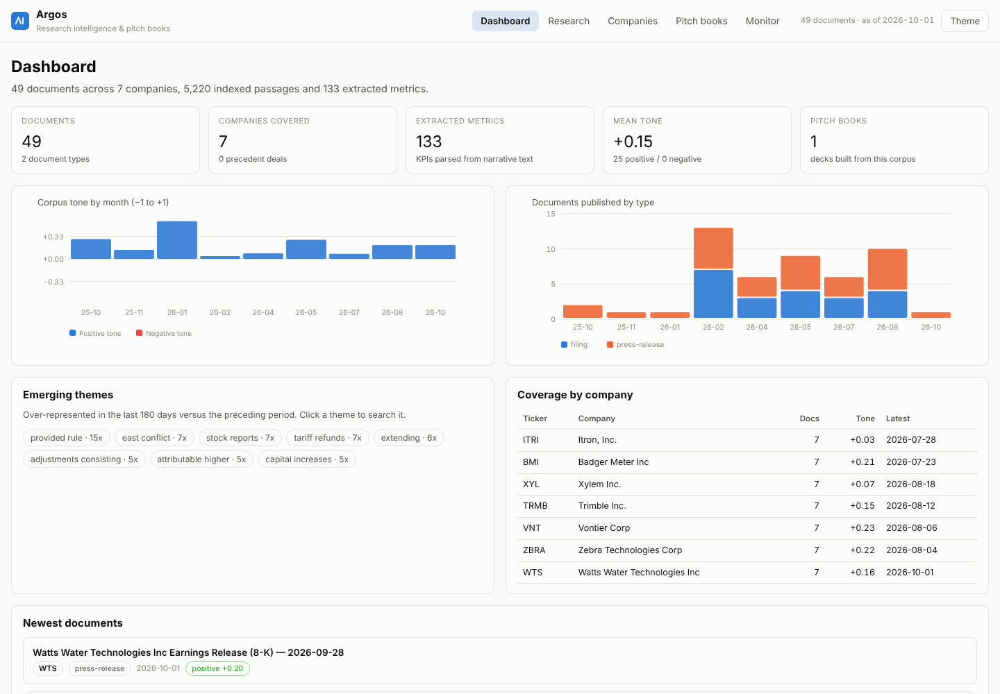
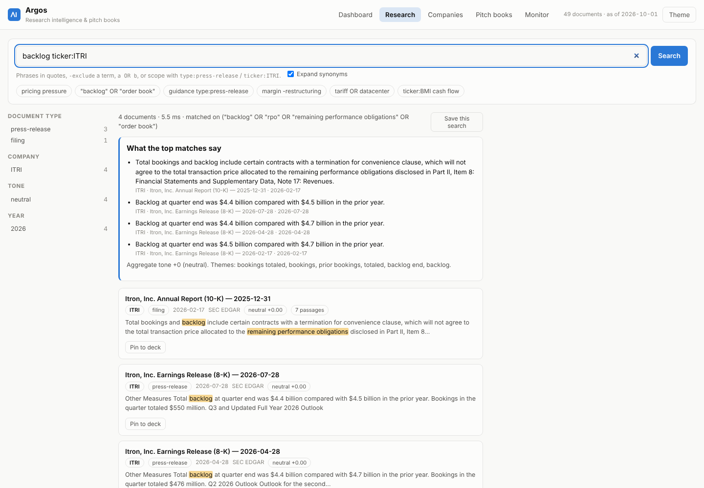
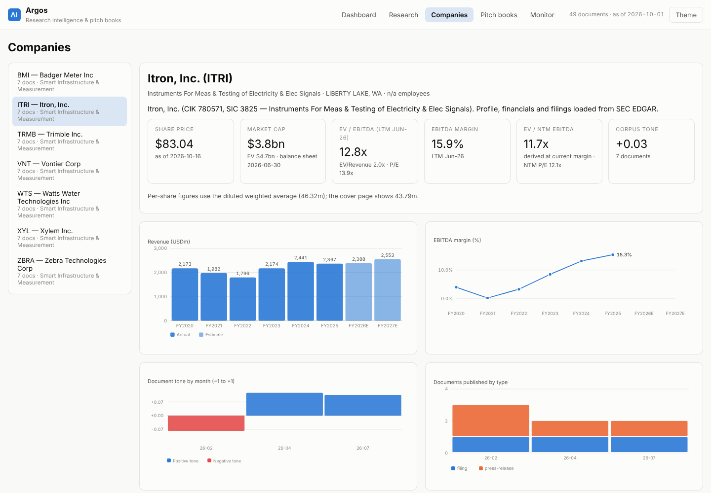
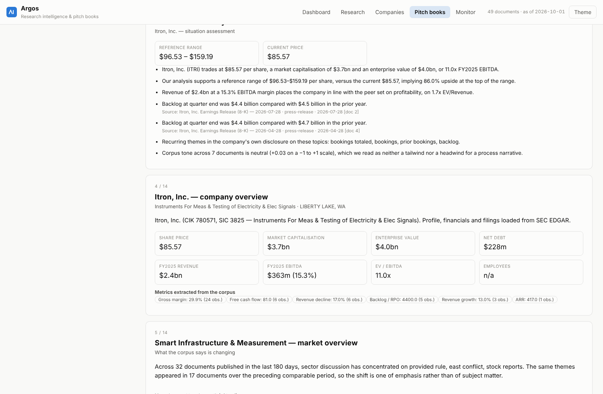
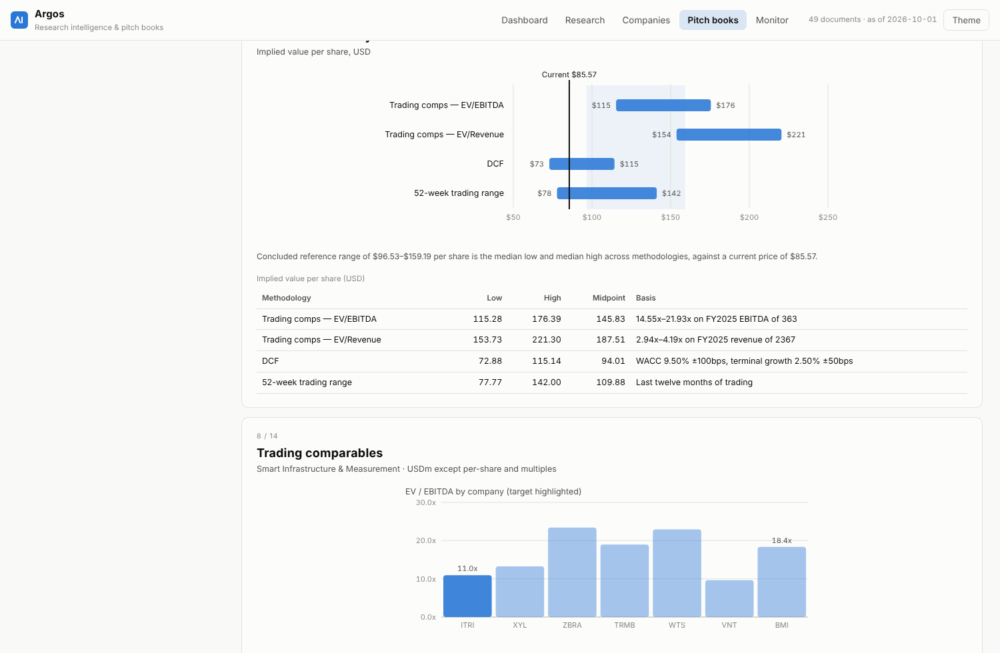
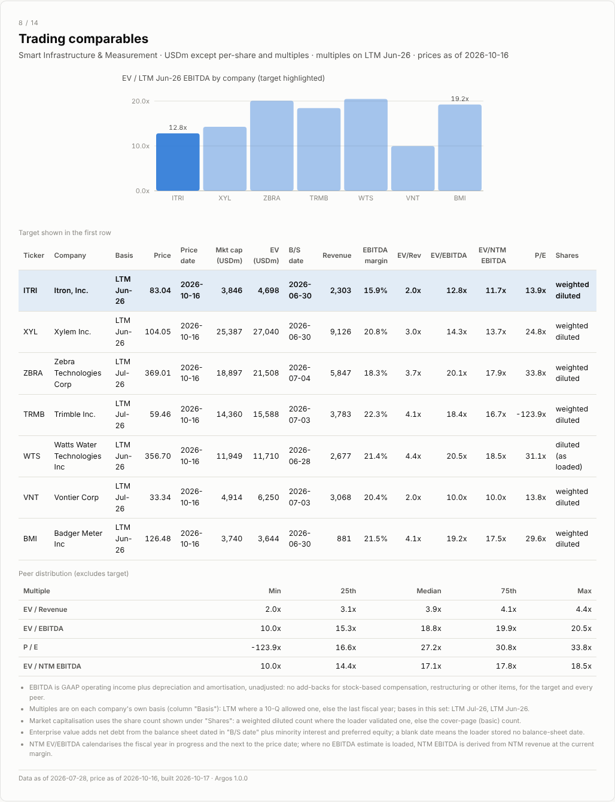
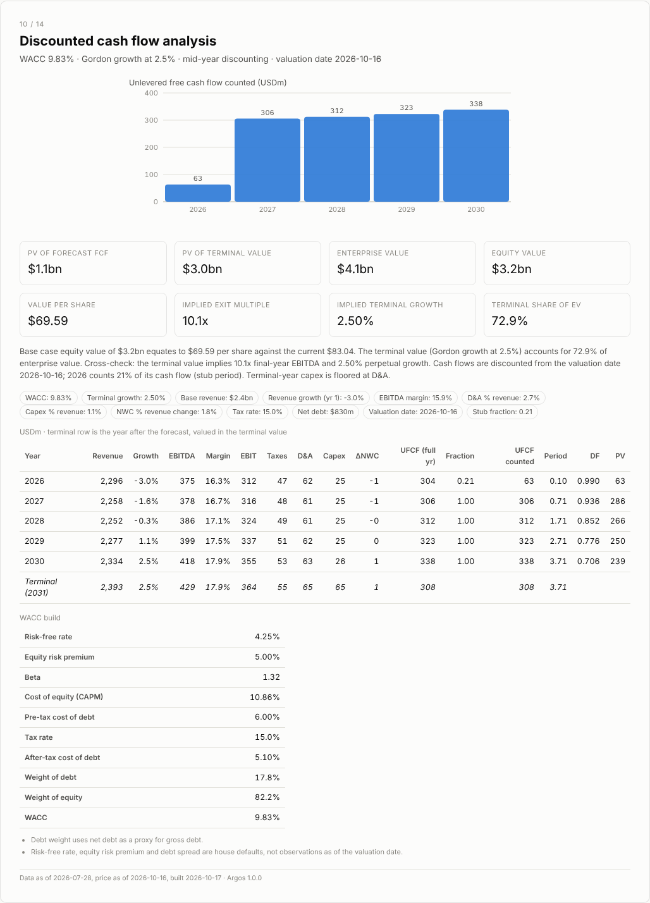

# Tutorial: from an empty database to a pitch book, on real SEC data

This walks through one complete session with Argos using live public data:
seven US-listed companies, their actual filed financials, their 10-Ks, 10-Qs
and earnings releases, and a current quote. By the end you will have a
searchable corpus of 49 real filings and an exported pitch book for Itron,
Inc. (NASDAQ: ITRI) — and, more usefully, you will know what every number on
its valuation page is made of.

Everything below was run on 12–13 October 2026. Prices move and companies file,
so your figures will differ in detail; the shape of the exercise will not.

> **Revised 17 October 2026 after an independent audit** (`docs/AUDIT.md`).
> The first version of this tutorial bridged the valuation through a net-debt
> figure from the December 2025 10-K, quoted multiples on fiscal 2025, used a
> constant WACC and described a peer-multiple range as "upside". The loader and
> the valuation now use the latest 10-Q balance sheet, LTM and consensus NTM
> figures, a built-up WACC and a conclusion that excludes reference bars, and
> every figure below was regenerated with that code on 16–17 October 2026
> prices. One known artefact remains in this Python build: broad search counts
> can be lower than their facets (the Rails port corrects it).

> **Data sources.** Fundamentals and filings come from SEC EDGAR's public APIs
> (`data.sec.gov`, `sec.gov/Archives`). The quote comes from a public quote
> endpoint. Neither is a licensed data feed: fine for learning and for internal
> work, not something to redistribute as a product. SEC asks automated clients
> to identify themselves — set `ARGOS_USER_AGENT="YourName your@email"` before
> loading at any volume.

---

## 0. Setup (two minutes)

```bash
git clone -b claude/alpha-sense-pitch-book-7wu8xc https://github.com/uouo1/tee2.git
cd tee2
pip install -r requirements.txt     # optional: only for PowerPoint and PDF export
python3 -m unittest discover -s tests -t .
```

Argos needs nothing beyond Python 3.11+ for search, valuation, the web UI and
HTML export. The suite should report `OK`.

We will keep the real data in its own database file so the synthetic demo
corpus (`argos seed`) stays available for comparison:

```bash
export ARGOS_DB=data/real.db
```

---

## 1. Load a target and its peers from EDGAR

Itron sells smart meters and grid-edge software to utilities. A defensible
trading-comp set is companies that sell measurement and control technology into
utility and industrial customers: Badger Meter (BMI), Xylem (XYL), Trimble
(TRMB), Vontier (VNT), Zebra Technologies (ZBRA) and Watts Water (WTS). All are
SEC filers, so one command loads all of them:

```bash
python3 -m argos load-sec ITRI BMI XYL TRMB VNT ZBRA WTS \
    --sector "Smart Infrastructure & Measurement"
```

Three minutes later (downloads are cached under `data/cache/`, so a re-run takes
seconds):

```json
{
  "companies": 7,
  "documents_added": 49,
  "failures": [],
  "loaded": [
    {"ticker": "ITRI", "name": "Itron, Inc.", "cik": "0000780571",
     "fiscal_years": [2020, 2021, 2022, 2023, 2024, 2025],
     "latest_revenue": 2367.2, "ltm_period_end": "2026-06-30",
     "shares_basis": "weighted_diluted", "net_debt_as_of": "2026-06-30",
     "estimate_years": [2026, 2027], "share_price": 83.04,
     "quote_as_of": "2026-10-16", "documents_added": 7},
    ...
  ]
}
```

### What just happened

For each ticker the loader did five things, and it is worth knowing which
number came from where, because that is what makes the deck defensible later.

**1. Resolved the company.** `sec.gov/files/company_tickers.json` maps ITRI to
CIK 780571. The submissions feed supplies the legal name, SIC code and business
address. `--sector` overrides the SIC description with one label for the whole
set, which is what the comp-suggestion and precedent-transaction screens key on.

**2. Pulled six years of fundamentals from XBRL**, not from parsed text. The
`companyfacts` API carries every tagged value the company ever filed. The loader
selects, per fiscal year, the **full-year** value (330–400 day spans, so a
fourth-quarter figure is never mistaken for a year) from the **most recently
filed** 10-K (so restatements win), using a preference order of tags because
filers tag the same line differently:

| Concept | Tags tried, in order |
|---|---|
| Revenue | `RevenueFromContractWithCustomerExcludingAssessedTax`, `Revenues`, `SalesRevenueNet` … |
| EBIT | `OperatingIncomeLoss` |
| D&A | `DepreciationDepletionAndAmortization` …, else `Depreciation` + `AmortizationOfIntangibleAssets` |
| Net income, EPS, capex, pre-tax income, tax | the usual `us-gaap` tags |
| Net debt | `LongTermDebtCurrent` + `LongTermDebtNoncurrent` (else a total-debt tag) − cash − short-term investments, read at the **latest balance sheet** in the facts, 10-K or 10-Q, with its date stored; `MinorityInterest` and preferred stock are deducted in the EV bridge |
| Shares | weighted diluted `WeightedAverageNumberOfDilutedSharesOutstanding` when it is from the latest fiscal year and within 0.5–2× of the cover-page count, else the cover page; the cover-page count is kept as "basic" |
| LTM | fiscal year + latest 10-Q year-to-date − prior-year year-to-date, per line, on the fiscal year's own tag |
| Consensus | revenue and EPS for the fiscal year in progress and the next, plus beta, from the public quote summary |

Tags are resolved **per year**: a filer that switched tags keeps every year,
and a revenue tag worth less than a fifth of another tag's figure for the same
year is treated as a sub-line, not the total.

**EBITDA is operating income plus D&A.** That is the standard proxy and it is
*not* the "adjusted EBITDA" a company reports in its own release (which adds
back stock compensation, restructuring and so on). Keep that in mind when you
compare the multiples below to a broker's.

Here is what came back for Itron (USD millions, fiscal years to 31 December):

| FY | Revenue | EBITDA | EBIT | Net income | EPS | Capex | Tax rate |
|---|---:|---:|---:|---:|---:|---:|---:|
| 2020 | 2,173.3 | 86.9 | −10.4 | −58.0 | −1.44 | 46.2 | — |
| 2021 | 1,981.6 | 4.9 | −79.3 | −81.3 | −1.83 | 34.7 | — |
| 2022 | 1,795.6 | 59.3 | −7.4 | −9.7 | −0.22 | 19.7 | — |
| 2023 | 2,173.6 | 184.6 | 128.9 | 96.9 | 2.11 | 26.9 | 22.8% |
| 2024 | 2,440.8 | 320.4 | 264.1 | 239.1 | 5.18 | 30.6 | 15.3% |
| 2025 | 2,367.2 | 362.6 | 313.1 | 301.1 | 6.50 | 22.9 | 11.4% |

The trailing twelve months to 30 June 2026 (FY2025 plus the first half of 2026
less the first half of 2025): revenue **2,303.2**, EBITDA **366.6**, EPS 5.98.
That row, labelled "LTM Jun-26", is what the multiples are quoted on.

Net debt at the latest balance sheet (10-Q, 30 June 2026): $1,575.2m of debt
less $745.2m of cash = **$830.0m**, plus $21.9m of non-controlling interest
deducted in the bridge. The December 2025 10-K showed $227.9m; the February 2026
convertible and the buyback since then are why the bridge reads the newest
filing, not the last fiscal year end. Shares: **46.32m** diluted weighted
average for FY2025 (the per-share basis), 43.79m on the cover page.

**3. Fetched a quote**: $83.04 on 16 October 2026, 52-week range $77.77–$142.00.

**4. Fetched consensus and beta**: FY2026 revenue $2,388m and EPS $6.42, FY2027
$2,553m and $7.00 (9 analysts), beta 1.32. These become estimate rows and feed
the NTM multiples and the WACC build.

**5. Downloaded the filings and indexed them.** The latest 10-K, the two most
recent 10-Qs and the four most recent 8-K earnings releases (the loader finds
the EX-99.1 exhibit inside each 8-K; filers name that file every way
imaginable). Each document is converted from inline-XBRL HTML to paragraphs,
chunked, scored for tone, scanned for KPIs and indexed in FTS5. The 49 documents
became 5,220 searchable passages and 133 extracted metrics.

Check the result:

```bash
python3 -m argos stats
```

---

## 2. Research the target

Start the application on the real database and open <http://127.0.0.1:8787>:

```bash
python3 -m argos serve
```



### A search that pays off immediately

Go to **Research** and search `backlog ticker:ITRI`.



Four documents match. The summary card at the top has done the first hour of an
analyst's work: it has pulled, from three consecutive earnings releases, the
sentences that carry the number —

> Backlog at quarter end was $4.5 billion compared with $4.7 billion in the prior year. *(8-K, 17 Feb 2026)*
> Backlog at quarter end was $4.4 billion compared with $4.7 billion in the prior year. *(8-K, 28 Apr 2026)*
> Backlog at quarter end was $4.4 billion compared with $4.5 billion in the prior year. *(8-K, 28 Jul 2026)*

— and, from the 10-K, the caveat that backlog includes contracts with
termination-for-convenience clauses. That is the research finding and its
footnote, each traceable to an accession number.

Notice the line under the result count: `matched on ("backlog" OR "rpo" OR
"remaining performance obligations" OR "order book")`. Synonym expansion is on
by default because filings and analysts use different words for the same
thing; untick **Expand synonyms** to see only literal matches.

Try a few more. `tariff` lists 15 documents across the set (its facet counts
28: this Python build ranks a top slice of passages before collapsing to
documents, an artefact the Rails port removes) — Watts, Badger Meter and Xylem
all discuss reciprocal tariffs and the Supreme Court case in their 2026 10-Qs. `margin expansion type:press-release` surfaces Vontier's
guidance language ("adjusted operating profit margin expansion of approximately
110 basis points"). `"data center" OR datacenter` shows Badger Meter attributing
component demand to hyperscale build-out.

Click any result: the reader on the right shows the whole document, the metrics
parsed from it, per-passage tone, nearest-neighbour filings, and a **Pin to
deck** button on every passage. We will use that in step 5.

### The company page

**Companies → ITRI**:



Tiles show the live capital structure — $83.04, market cap $3.8bn, EV $4.7bn
(net debt dated 30 June 2026), 12.8x LTM Jun-26 EV/EBITDA and 11.7x NTM,
15.9% LTM margin. The revenue chart shows the FY2021–22 trough and recovery;
the margin chart shows the expansion from 4% to 15% that is the whole Itron
equity story, with the consensus years shaded as estimates. Under the tiles a
line says which share count the per-share figures rest on. Below are the KPIs extracted from narrative text (gross
margin observed 24 times, backlog five times, free cash flow six) with the
sentence each came from.

---

## 3. Generate the pitch book

From the company page, **Generate deck**, or from the command line:

```bash
python3 -m argos pitchbook ITRI --title "Project Meter" \
    --client "Board of Itron, Inc." --banker "Argos Advisory" \
    --comps BMI,XYL,TRMB,VNT,ZBRA,WTS --export pptx
```

```
pitchbook 1: Project Meter — 14 slides
   0  cover                  Project Meter
   1  disclaimer             Disclaimer
   2  executive_summary      Executive summary
   3  company_overview       Itron, Inc. — company overview
   4  market_overview        Smart Infrastructure & Measurement — market overview
   5  financial_performance  Itron, Inc. — financial performance
   6  valuation_summary      Valuation summary
   7  trading_comps          Trading comparables
   8  precedent_transactions Precedent transactions
   9  dcf                    Discounted cash flow analysis
  10  dcf_sensitivity        DCF sensitivity
  11  buyers                 Potential counterparties
  12  process                Process considerations and next steps
  13  evidence_appendix      Appendix — sources and evidence
exported: data/exports/pitchbook-1.pptx
```

Open **Pitch books** in the UI to read it. The executive summary quotes the
corpus — the three backlog sentences above appear with their document ids — and
the market overview is the theme model run across the whole set.



---

## 4. Read the valuation page like a banker



This is the slide that matters, so here is every bar. Every multiple names its
basis, and the slide says which bars the conclusion rests on.

**Trading comps — NTM EV/EBITDA: $107–$136.** The six peers trade between 10.0x
(Vontier) and 18.5x (Watts) next-twelve-month EBITDA. Argos takes the
interquartile range, 14.43x–17.84x, applies it to Itron's NTM EBITDA of $401m,
subtracts $830m of net debt and $21.9m of non-controlling interest, and divides
by 46.32m diluted shares. Itron's NTM EBITDA is *derived*: consensus publishes
revenue and EPS, not EBITDA, so NTM revenue ($2,519m, 21% of FY2026 and 79% of
FY2027 at the 16 October price date) is run at the LTM margin, and the slide
says so.

**Trading comps — LTM EV/EBITDA: $103–$139.** The same peers on trailing EBITDA
trade between 10.0x (Vontier) and 20.5x (Watts); the interquartile range
15.31x–19.85x applied to $366.6m of LTM EBITDA.



**Trading comps — EV/Revenue: $138–$187, shown but excluded.** Itron's 15.9%
EBITDA margin is below the peers' interquartile range (20.5%–21.5%), so a
revenue multiple prices a more profitable business than Itron is. The bar is
drawn, marked excluded, and left out of the conclusion.

**DCF: $56–$91, base case $69.59.** Five years of unlevered free cash flow from
the valuation date, mid-year discounting, Gordon-growth terminal value. The
assumptions are seeded from Itron's own filings: year-one revenue growth −3.0%
(FY2025 was down on FY2024), interpolating linearly to 2.5% terminal growth;
15.9% LTM EBITDA margin expanding 40bps a year; D&A 2.7% and capex 1.1% of
revenue, with terminal-year capex floored at D&A; working-capital investment at
1.8% of the *change* in revenue; tax at the 15% floor of a normalised band
(Itron's filed effective rate was 11.4%). Only the 21% of FY2026 still ahead on
16 October counts, and every flow is discounted from that date. The WACC is
built, not assumed: a 4.25% risk-free rate plus beta 1.32 × a 5% equity premium
gives a 10.86% cost of equity; debt at 6.0% pre-tax carries a 17.8% weight;
WACC 9.83%. The terminal value is 73% of enterprise value and implies a 10.1x
exit multiple, both printed on the slide. The bar is the range across WACC
±100bps and terminal growth ±50bps; the full sensitivity grid is the next slide.



**52-week range: $78–$142, reference only.** Where the market has been is not
a valuation method, so it is drawn for context and never averaged in.

**Concluded range: $102.78–$136.05** — the median of the lows and the median of
the highs across the three methods in the conclusion (NTM comps, LTM comps,
DCF). Not the widest bar, and not the narrowest: one methodology cannot dictate
the answer. The deck calls this "implied value at peer multiples and DCF", not
upside: the repository's own backtest (`docs/backtests/comps-2016.md`) found
no evidence that a cheap-versus-peers EV/EBITDA gap predicted forward returns,
so a comps bar is a statement about relative pricing, not a forecast.

### Reading it honestly

The comps bars sit above the current price while the DCF sits below it. That
is not a bug; it is the finding. Itron trades at 12.8x LTM EBITDA against a
peer interquartile range of 15.3x–19.9x because its margin (15.9%) is the
lowest in the group — the executive summary now says exactly that, "below the
peer median of 21.1% across 6 peers", and the counterparties slide quotes each
peer's margin and multiple against Itron's instead of calling every peer
accretive. A comps-driven view says "re-rate to the peers"; a cash-flow view,
with a 9.8% WACC and a 2.3x levered balance sheet after the 2026 convertible,
says "the current price is about right for the cash this business generates
today". A real pitch would argue which one the buyer should believe, and this
page gives you both with their inputs exposed.

Change an input and watch it move: on the deck page, open **DCF assumptions —
edit and rebuild**, set WACC to `0.11`, apply. The DCF bar drops; the comps bars
do not. Change the comp set (remove Zebra and Watts, the two most expensive
names) and the comps bars drop instead. Hand-edited slides are pinned and
survive these rebuilds.

### The precedent transactions page is empty — on purpose

Deal multiples are not in EDGAR in any consistent, machine-readable form, so
Argos does not pretend to have them. The slide says so, and the valuation
summary omits the precedent bar rather than inventing one. When you have a
transaction screen, load it:

```bash
python3 -m argos load-transactions deals.csv
python3 -m argos export 1 --format pptx      # or Rebuild in the UI
```

with the columns in `docs/precedent-transactions-template.csv`
(`announced_on, target, acquirer, sector, ev, ev_revenue, ev_ebitda,
premium_1day, consideration, note`). The precedent range, the control-premium
bullet on the process slide and the sponsor rationale all fill in.

---

## 5. Pin evidence

Back in **Research**, search `tariff ticker:BMI`, open the Badger Meter 10-Q and
press **Pin to deck** on the paragraph about reciprocal tariffs. Pick *Project
Meter*, add a note ("diligence: tariff exposure in the peer set"), pin.

The appendix slide now carries the quote, the filing it came from, its date and
your note. Pin a dozen passages while you research and the evidence appendix
writes itself — every claim in the front half of the deck has a source in the
back half.

---

## 6. Export

From the deck toolbar, or:

```bash
python3 -m argos export 1 --format pptx --out project-meter.pptx
python3 -m argos export 1 --format pdf  --out project-meter.pdf
python3 -m argos export 1 --format html --out project-meter.html
```

The PowerPoint charts are native, editable chart objects — the football field
is a stacked bar with an invisible base series, exactly as you would build it
by hand — so a banker can retype a number at 11pm without coming back to the
application. The HTML is a single self-contained file that prints to PDF.

---

## 7. Keep it current

Every command is idempotent. Re-run the load after the next earnings release
and only the new 8-K is ingested; rebuild the deck and the executive summary
picks up the new backlog figure:

```bash
python3 -m argos load-sec ITRI BMI XYL TRMB VNT ZBRA WTS --sector "Smart Infrastructure & Measurement"
curl -X POST http://127.0.0.1:8787/api/pitchbooks/1/rebuild
```

Save the backlog search (**Save this search**) and the **Monitor** tab will
list new matches each time you load.

---

## What to be careful about

These are the judgement calls the loader makes. They are reasonable defaults,
and you should know them before you put a number in front of anyone.

* **EBITDA is EBIT + D&A**, not adjusted EBITDA. Zebra's release reports a
  27.7% *adjusted* EBITDA margin; the XBRL-derived figure is lower. Compare like
  with like.
* **Fiscal years are labelled by period end**, with early-January year ends
  assigned to the prior year (Trimble's year ending 2 January 2026 is FY2025).
* **Working capital excludes cash and debt.** Itron's convertible notes moved
  into current liabilities in 2025; counting that as a working-capital release
  would add $460m to every projected cash flow. (It did, in an earlier version
  of this loader — the DCF came out at $266 a share. That bug is why the
  tutorial explains the inputs.)
* **The tax rate in the DCF is held between 15% and 35%**; a single year's
  effective rate is not a forecast.
* **Multi-class filers** (Watts Water) have no single cover-page share count in
  the facts feed; the loader uses the weighted diluted count alone and leaves
  the basic count blank. Badger Meter tags no debt line at all, so its net debt
  is bridged at zero debt with a note saying so (`debt_note`).
* **Net debt is read at the latest 10-K or 10-Q**, dated on the comps page.
  Between filings it is stale by up to a quarter; a convertible issued since
  the last balance sheet is not in it until the next 10-Q.
* **Theme detection on filing text is noisy.** Earnings releases carry the
  signal ("tariff refunds", "Middle East conflict" rose in the last 180 days);
  10-Q boilerplate is filtered but not perfectly. Treat the market-overview
  theme table as a prompt for reading, not a conclusion.
* **The quote is a public endpoint**, unlicensed and occasionally unavailable.
  If a company loads with no market data, re-run; the fundamentals and filings
  are unaffected.
* **Consensus and beta come from the same public quote endpoint as the
  price**: unofficial and unlicensed, nine analysts for Itron. No source
  publishes consensus EBITDA for free, so NTM EBITDA is derived from consensus
  revenue at the current margin and labelled as such. The WACC build's
  risk-free rate, equity premium and debt spread are house defaults printed on
  the DCF slide; override them per deck through the assumptions panel.

---

## Reproduce exactly

```bash
export ARGOS_DB=data/real.db ARGOS_USER_AGENT="Your Name your@email.example"
python3 -m argos load-sec ITRI BMI XYL TRMB VNT ZBRA WTS --sector "Smart Infrastructure & Measurement"
python3 -m argos pitchbook ITRI --title "Project Meter" --client "Board of Itron, Inc." \
    --banker "Argos Advisory" --comps BMI,XYL,TRMB,VNT,ZBRA,WTS --export pptx
python3 -m argos serve
```

The HTTP API (`docs/api.md`) exposes everything the UI does, so the same session
can be scripted end to end.
